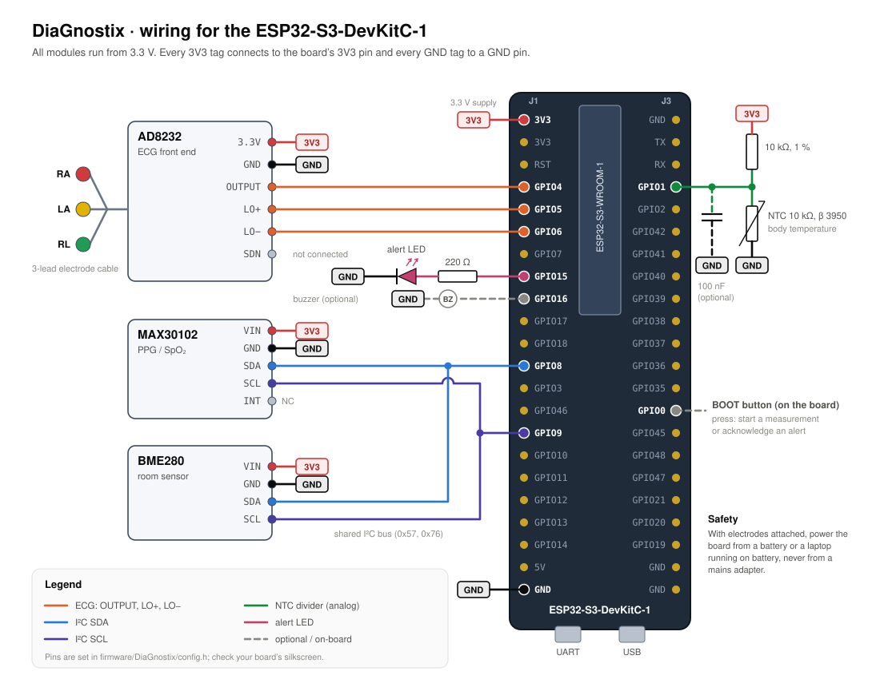

# Hardware: ESP32-S3 N16R8 build of DiaGnostix-ECG

The wiring is shown in [wiring-diagram.svg](wiring-diagram.svg). The ECG is the main input of the risk model, so three things matter most:
- electrode placement;
- the AD8232 gain;
- signal quality.

## Bill of materials

| Qty | Part | Notes |
|---:|---|---|
| 1 | ESP32-S3-DevKitC-1 **N16R8** (16 MB flash, 8 MB octal PSRAM) | PSRAM is required: the ECG analysis buffers (≈ 360 KB) live there |
| 1 | AD8232 single-lead ECG module (SparkFun-type, gain ≈ 1100) | with the 3-lead cable (red RA, yellow LA, green RL) |
| 3 | disposable Ag/AgCl gel electrodes | replace after every session |
| 1 | MAX30102 pulse-oximeter module | optional for the risk model (SpO₂, blood pressure) |
| 1 | BME280 module (I2C) | room temperature and humidity (context only) |
| 1 | 10 kΩ NTC thermistor, B = 3950, + 10 kΩ 1 % resistor (+ 100 nF) | skin temperature; fever warning |
| 1 | 5 mm LED + 220 Ω resistor | alert LED |
| – | breadboard, jumper wires, USB cable, **battery power bank** | see *Electrical safety* |
| (calibration) | function generator, or any sine source, + 1 kΩ and 1 MΩ 1 % resistors | one-off AD8232 gain calibration |

## Wiring



| Module | Pin | ESP32-S3 | Notes |
|---|---|---|---|
| AD8232 | 3.3V / GND | 3V3 / GND | never 5 V |
| | OUTPUT | **GPIO4** (ADC1) | sampled at 500 Hz with `analogReadMilliVolts()`, 11 dB attenuation (0–3.1 V) |
| | LO+ / LO− | GPIO5 / GPIO6 | lead-off detection; samples taken while a lead is off are marked and their window is discarded |
| MAX30102 | VIN / GND, SDA / SCL | 3V3 / GND, GPIO8 / GPIO9 | I2C 0x57 |
| BME280 | VIN / GND, SDA / SCL | 3V3 / GND, GPIO8 / GPIO9 | I2C 0x76 or 0x77 |
| NTC | divider node | GPIO1 (ADC1) | 3V3 – 10 kΩ – node – NTC – GND |
| LED | anode via 220 Ω | GPIO15 | cathode to GND |

All pins are in [`firmware/DiaGnostixECG/config.h`](../firmware/DiaGnostixECG/config.h). On the N16R8, GPIO26–37 are taken by the flash and the octal PSRAM; `config.h` refuses to compile if a pin is moved onto them.

## Arduino IDE settings (N16R8)

| Setting | Value |
|---|---|
| Board | ESP32S3 Dev Module (esp32 by Espressif Systems 3.x) |
| Flash Size | 16MB (128Mb) |
| Partition Scheme | 16M Flash (3MB APP/9.9MB FATFS) |
| PSRAM | **OPI PSRAM** |
| USB CDC On Boot | Enabled for the "USB" port, Disabled for the "UART" port |

At start-up, the Serial Monitor (115200 baud) prints:
- the board summary, e.g. `[board] ESP32-S3 … flash 16 MB, PSRAM 8 MB`;
- the buffer allocation, `[ecg] analysis buffers: 303 KB extractor + 58 KB capture (PSRAM)`;
- the boot self-test, `[model] self-test passed: … ms per 10-s window`.

## Electrode placement: lead I

The models were trained on **lead I** of a clinical 12-lead ECG: the potential of the left arm minus the right arm. The AD8232 measures LA − RA, so the electrodes must sit on the arms:

| Lead | Colour (typical cable) | Position |
|---|---|---|
| RA | red | inside of the **right wrist** (or right forearm) |
| LA | yellow | inside of the **left wrist** (or left forearm) |
| RL | green | **right leg**: inside of the ankle or lower leg (reference) |

**How to get a clean recording**
- Clean the skin with alcohol and let it dry.
- Use fresh gel electrodes.
- Sit with your back supported and your forearms resting on the table.
- Do not talk or move during the 33-s measurement.
- The R wave must point **upwards** on the dashboard. If it points down, RA and LA are swapped: swap them back, or set `ECG_INVERT true` in `config.h`.

**Avoid chest placement.** It gives a different lead, with different amplitudes and shapes, from the one the models were trained on.

## AD8232 gain calibration

The model reads ECG amplitudes in microvolts. The firmware computes them as:

```
µV at the electrodes = (mV at GPIO4 − 1650) × 1000 / gain
```

The nominal gain of the common AD8232 module is 1100: 100 in the instrumentation amplifier × 11 in the output stage. The output stage is set by board resistors, so individual boards differ. Electrode placement also changes the amplitude.

**Until the gain is calibrated, the device uses the gain-invariant fallback model.** That model uses only the ECG timing, the heart-rate variability and the T/R ratio, together with the profile. The notebook (Section 12d) quantifies how much an amplitude error moves the full model's sensitivity and specificity.

**Procedure with a sine reference (dashboard → ECG gain calibration):**
1. Disconnect the electrodes from your body.
2. Build a 1000 : 1 divider: generator output → 1 MΩ → node → 1 kΩ → generator ground.
3. Set the generator to a 10 Hz sine of 1.00 V peak-to-peak. The node then carries ≈ 1.00 mV peak-to-peak; use 1 % resistors.
4. Connect RA (red) to the node, LA (yellow) to the generator ground, and RL (green) to the generator ground as well.
5. Enter `1.0` mV and press **Calibrate gain**.

The device then measures for 6 s. It computes the gain from the RMS of the sine (peak-to-peak = 2√2 × RMS) and stores it in flash. A plausible result is 500–2000; anything else is rejected.

Any frequency between 5 and 20 Hz works: the AD8232 module's 0.5–40 Hz band-pass is flat there. If you measured the gain another way (e.g. with an oscilloscope on GPIO4), enter it under **Measured gain**. **Reset to nominal** returns to the fallback model.

## Electrical safety

Electrodes connect the circuit to the body. While electrodes are attached, power the device from a battery: a power bank, or a laptop running on battery and disconnected from its charger. Never use it while connected to a mains-powered computer or wall adapter without a medical-grade isolation barrier. The AD8232 module is not a medical device and provides no patient isolation.
